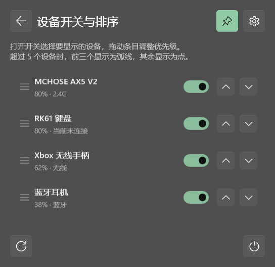

# 环电 · PeriRing


**用一圈，掌握外设电量。**

环电是一款 Windows 托盘外设电量工具，使用 WinUI 3 与 Fluent 界面。把多个外设的电量汇总在一个分段圆环里，悬停看数值，点击展开设备，右键完成常用操作。

[下载最新版本](https://github.com/echoinzephyr/PeriRing/releases/latest) · [设备支持列表](SUPPORTED-DEVICES.md) · [更新记录](CHANGELOG.md) · [反馈问题](https://github.com/echoinzephyr/PeriRing/issues)

## 界面预览

以下为程序实际渲染的 WinUI 界面，使用示例设备与电量展示功能；截图中的数值不代表对应型号的硬件验证结果。

<table>
  <tr><th>设备浮层</th><th>设备选择与优先级</th></tr>
  <tr>
    <td valign="top"></td>
    <td valign="top"></td>
  </tr>
</table>

<details>
  <summary>展开查看设置界面</summary>
  <p>设备与显示、常规、关于分组排列，开关和选项统一放在右侧。</p>
  
</details>

## 下载与运行

1. 从 [Releases](https://github.com/echoinzephyr/PeriRing/releases/latest) 下载 `PeriRing-v版本号-win-x64.zip`。
2. 完整解压到一个可写目录，运行其中的 `BatteryDisplay.exe`。程序启动后驻留托盘。
3. 若任务栏没有显示图标，打开通知区域的 **^**，将环电拖到常驻区域。

**请保留整个解压目录。** 程序依赖旁边的 DLL、`resources.pri`、`App.xbf` 和图标文件，不能只复制 EXE。

| 运行环境 | 要求 |
|---|---|
| 系统 | Windows 10 2004 或更新版本，x64 |
| .NET | [.NET 10 Desktop Runtime，x64](https://dotnet.microsoft.com/download/dotnet/10.0) |
| WinUI 运行环境 | [Windows App Runtime 2.6，x64](https://learn.microsoft.com/windows/apps/windows-app-sdk/downloads) |

当前下载包依赖已安装的运行环境。发布页面同时提供 SHA256 校验文件。

## 日常操作

| 操作 | 功能 |
|---|---|
| 悬停托盘图标 | 紧凑显示“设备名：电量” |
| 点击托盘图标 | 展开或收起设备浮层；每次重新展开自动读取电量 |
| 右键托盘图标 | 刷新、选择设备、排序、自启、外观、检查更新、退出 |
| 浮层左下角刷新按钮 | 立即重新读取；读取期间禁用，避免重复请求 |
| 浮层顶部图钉 | 保持浮层展开；未固定时，失去焦点会收起 |
| 拖动浮层边缘 | 调整大小，尺寸自动保存 |
| 设备卡片右侧图钉 | 选择该设备是否参与托盘显示 |

关闭浮层后程序仍在托盘运行。通过右键菜单或浮层右下角的退出按钮结束程序。重复启动会唤出已经运行的实例。

### 圆环怎样表示电量

| 参与显示的在线设备数 | 图标形式 |
|---|---|
| 1–5 个 | 圆环分成相等的区域，每台设备对应一段曲线，曲线长度随电量变化 |
| 超过 5 个 | 优先级最高的 3 台显示曲线，其余每台对应一个点；例如 6 台显示 3 段曲线 + 3 个点 |
| 电量不高于 20% | 对应曲线或点变为红色 |
| 暂无可显示的在线设备 | 显示空闲图标，不把未知电量当成 0% |

托盘图标会根据任务栏 DPI 选择实际像素尺寸，并在缩放变化时重新生成。支持关闭环形模式，改为显示最低的精确电量数字；只有档位、没有精确百分比的设备仍可在悬停提示中查看。

### 设备开关与排序

在右键菜单进入“设备开关与排序”，用开关选择要显示的设备，再拖动条目或用上下箭头调整优先级。

优先级同时决定悬停列表的顺序，以及设备较多时哪些设备使用曲线。同款接收器保留各自的实例标识，不会只因为名称相同就合并。

接收器仍连接、鼠标休眠或暂未响应时，保留上次有效电量，浮层和悬停提示会注明“上次读数”。唤醒后读取成功即更新，拔出接收器后退出托盘显示。普通蓝牙断开历史仍不参与托盘显示。

## 设置

| 分组 | 选项 | 说明 |
|---|---|---|
| 设备与显示 | 设备开关与排序 | 选择设备，并调整托盘优先级 |
| 设备与显示 | 分段环形图标 | 在圆环和最低电量数字模式之间切换 |
| 设备与显示 | 与官方驱动一致 | 对已接入厂商显示规则的设备采用分档值；关闭后显示原始读数 |
| 常规 | 低电量提醒 | 不高于 20% 且未充电时提醒一次；恢复到 25% 以上后允许再次提醒 |
| 常规 | 开机启动 | 登录当前 Windows 账号后自动驻留托盘，首次使用默认关闭 |
| 常规 | 外观 | 跟随系统、浅色或深色 |
| 常规 | 后台刷新 | 15 秒、30 秒、1 分钟或 5 分钟；默认 1 分钟 |
| 关于 | 支持设备 | 查看协议覆盖范围和读取渠道状态 |
| 关于 | 检查更新 | 查询本仓库最新正式版，提供发布页面和下载入口 |

睡眠恢复后会重新读取电量。设置保存在程序旁的 `data/settings.json`，接收器电量和读取时间保存在 `data/battery-cache.json`，程序目录需要可写。开机启动登记当前程序路径，移动目录后应关闭再开启该选项。

## 支持范围与实测情况

环电按协议适配设备。**同一品牌不代表全部型号兼容，能识别设备名称也不等于能读取电量。** 精确型号、读取渠道与验证状态见 [SUPPORTED-DEVICES.md](SUPPORTED-DEVICES.md)。

| 读取渠道 | 覆盖概况 |
|---|---|
| 蓝牙 | Windows 已上报的电量；已连接 BLE 设备的标准 Battery Service |
| USB / 2.4G 私有协议 | 已登记的迈从、罗技、雷蛇、ATK/VGN/VXE、Pulsar、WLmouse、LAMZU、Glorious、华硕、赛睿、HyperX、Keychron、部分海盗船与 SONiX 键盘接口 |
| 手柄 | 有效的 Windows 电池报告、XInput 电池档位，以及索尼手柄报告 |
| 飞智 | 新版 `SpaceStationService` 提供的电量档位；旧版空间站 3 暂不支持 |

目前已在真实硬件上验证：

- **MCHOSE AX5 V2**：2.4G 电量读取；原始 75% 按已核实的官方分档规则显示为 80%。
- **MCHOSE A7 Ultra(RE)**：2.4G 接收器已返回有效电量；与 AX5 V2 同时连接时能分别读取。
- **Valkyrie 75**：USB 有线型号识别；当前有线连接未取得电量，2.4G 电量查询尚待实测。
- 本机 Windows 蓝牙电量读取；标准 BLE 直读和其他多品牌适配仍有待对应硬件验证。

精确百分比、档位和估算值分别处理。例如只有电压的罗技设备会注明估算，只有档位的手柄不会被伪装成精确百分比。不同连接方式或固件可能使用不同协议；同一设备切换蓝牙、有线和 2.4G 后，目前不保证都能自动合并为同一条记录。

## 更新版本

右键选择“检查更新”，或在设置的“关于”分组中进入。发现新版后，点击下载入口获取 Windows x64 压缩包。

升级时先退出旧程序，再解压、替换运行文件，**保留 `data` 文件夹**即可保留设置。检查更新不会自动安装或执行下载文件。

## 常见问题

### 设备已连接，为什么电量是“—”？

“—”表示本次没有可靠读数，可能是系统未上报、协议尚未支持、设备休眠、官方驱动占用了接口，或当前连接方式不提供电量。先唤醒设备，再点击刷新。对于 2.4G 设备，插着接收器不等于外设已开机或建立无线连接。

已经成功读取过的接收器设备在暂未响应时会显示“上次读数”，可在提示中查看原读取时间。这表示历史电量；不会继续沿用旧的充电状态，也不会用它触发新的低电量提醒。首次使用还没有有效读数时，仍需先唤醒设备读取一次。

### 为什么和官方驱动不一样？

厂商界面可能对原始读数分档、平滑处理或延迟更新。已核实的规则可通过“与官方驱动一致”切换；将鼠标悬停在设备的电量数值上可查看相关原始信息。没有厂商显示规则的设备继续使用实际读数，不能保证所有型号都与官方界面逐点一致。

### 为什么 USB 有线连接不一定有电量？

供电、输入和电池上报是不同能力。某些设备只通过无线接收器或蓝牙提供电量，有线连接时可能只能确认设备存在。

### 为什么飞智手柄没有读数？

新版空间站使用已经安装并运行的 `SpaceStationService`，不需要打开驱动界面。

旧版空间站 3 暂不支持：已测试的接口无法提供可靠电量，因此不显示其估算值。部分 XInput 兼容模式本身不提供电量或只提供档位；没有有效读数时不会虚构百分比。

### 开机启动为什么不弹 UAC？

环电使用当前用户的 `HKEY_CURRENT_USER\Software\Microsoft\Windows\CurrentVersion\Run` 启动项，只在该账号登录后运行。写入此位置不需要管理员权限；程序本身也以普通用户身份启动。

### 如何反馈新设备？

在 [Issues](https://github.com/echoinzephyr/PeriRing/issues) 中提供品牌、完整型号、连接方式、固件和官方驱动的电量表现。可运行 `--diagnose` 生成本地诊断文件；其中有设备名称与标识，分享前请移除个人信息。不确定协议时，程序不会向未登记设备试发任意厂商命令。

## 开发与验证

需要 Windows x64、.NET 10 SDK，以及 Visual Studio 的 Windows 应用开发组件。项目使用 Windows App SDK / WinUI 3。

```powershell
git clone https://github.com/echoinzephyr/PeriRing.git
cd PeriRing
.\build.ps1
```

输出位于 `dist-winui`。脚本会调用 Visual Studio MSBuild，并将构建临时文件放在项目目录。

```powershell
# 生成与项目版本一致的干净下载包和 SHA256 文件
.\tools\Package-Release.ps1
```

发布脚本使用新的输出目录，检查运行必需的资源与许可证，排除个人设置、诊断和构建缓存。产物位于 `release`。

| 参数 | 功能 |
|---|---|
| `--show` | 启动时展开设备浮层 |
| `--diagnose` | 读取实际设备与 HID 接口，写入本地 `diagnostics.json` 后退出 |
| `--self-test` | 运行协议、图标、DPI 尺寸、排序和更新检查，生成 `self-test.json` |
| `--ui-self-test` | 使用示例设备验证原生开关、下拉框、快速开合与页面切换，生成 `ui-self-test.json`；建议在独立输出目录中运行 |
| `--check-update` | 查询版本并生成本地 `update-check.json`，不启动界面 |
| `--capture-ui` | 读取真实设备，生成 WinUI 页面截图后退出 |
| `--ui-preview --capture-ui` | 用示例设备生成界面截图，不将示例值用于真实设备读取 |

当前核心检查包含 128 项，另提供原生界面交互检查。检查通过只能说明相应逻辑通过验证，不能替代所有设备型号的实测。

### 项目结构

| 文件 / 目录 | 用途 |
|---|---|
| `WinUI/` | 托盘、浮层、菜单、设置与截图 |
| `TrayIcon.cs`、`SegmentedRing.cs` | 图标绘制、DPI 尺寸与设备分段规则 |
| `Providers.cs`、`DeviceScanner.cs` | 读取渠道聚合与蓝牙扫描 |
| `HidTransport.cs`、`*Adapter.cs` | HID 通信与各品牌协议适配 |
| `DeviceCatalog.json` | 型号和 USB 标识目录 |
| `UpdateService.cs` | GitHub 版本检查与下载链接验证 |
| `Assets/`、`docs/images/` | 品牌图标与界面截图 |

`IBatteryProvider` 隔离不同读取渠道，`IHidBatteryAdapter` 隔离品牌协议；一个读取渠道失败时，其他渠道继续工作。新增协议应限制设备匹配范围，并验证响应与边界情况。

## 隐私与许可证

设备读数、诊断和设置保存在本机。版本检查仅请求 GitHub 公开发布接口，不携带设备信息。程序仅进行状态读取，不修改 DPI、灯效、按键或手柄模式；索尼蓝牙适配监听已有报告，不主动切换增强模式。

项目遵循 [GPL-3.0](LICENSE)。协议来源和第三方声明见 [THIRD-PARTY-NOTICES.md](THIRD-PARTY-NOTICES.md)。

参考：[Windows 设备属性](https://learn.microsoft.com/windows/apps/develop/devices-sensors/device-information-properties)、[Bluetooth GATT](https://learn.microsoft.com/windows/apps/develop/devices-sensors/gatt-client)、[Windows 手柄电池报告](https://learn.microsoft.com/uwp/api/windows.gaming.input.igamecontrollerbatteryinfo.trygetbatteryreport)、[XInput 电池接口](https://learn.microsoft.com/windows/win32/api/xinput/nf-xinput-xinputgetbatteryinformation)。
