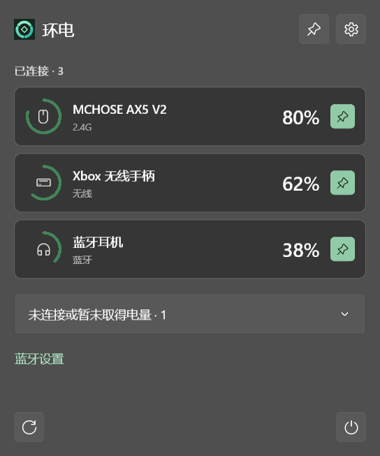
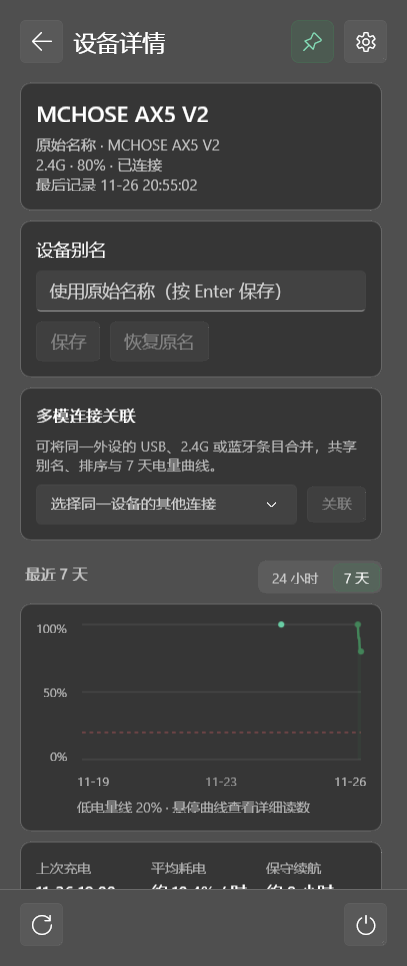
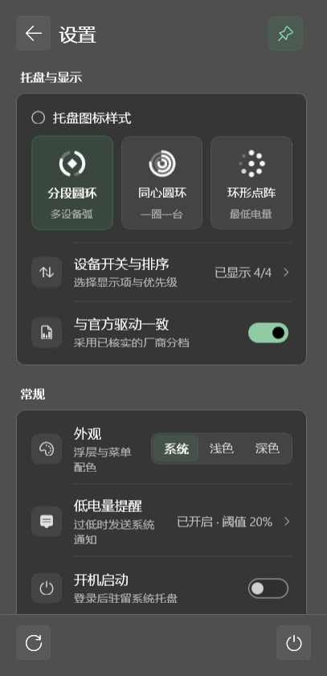
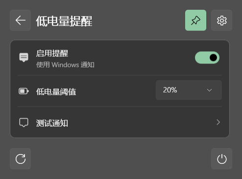
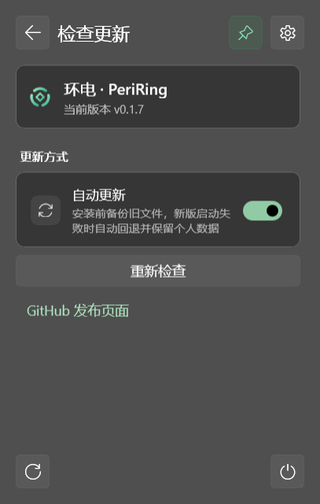
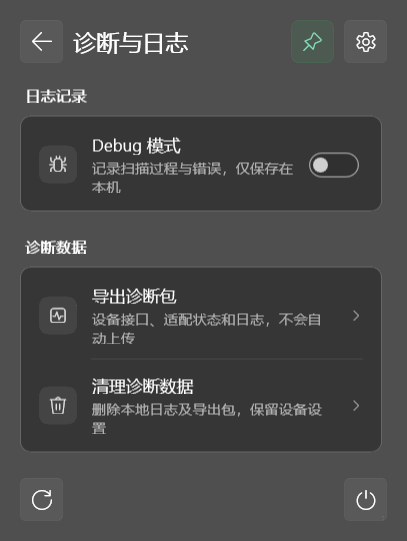

# 环电 · PeriRing


[](https://github.com/echoinzephyr/PeriRing/actions/workflows/ci.yml)
[](https://github.com/echoinzephyr/PeriRing/releases/latest)
[](https://github.com/echoinzephyr/PeriRing/releases)


[](LICENSE)

**用一圈，掌握外设电量。**

环电是一款 Windows 托盘外设电量工具，使用 WinUI 3 与 Fluent 界面。把多个外设的电量汇总在一个分段圆环里，悬停看数值，点击展开设备，右键完成常用操作。

[下载最新版本](https://github.com/echoinzephyr/PeriRing/releases/latest) · [设备支持列表](SUPPORTED-DEVICES.md) · [更新记录](CHANGELOG.md) · [反馈问题](https://github.com/echoinzephyr/PeriRing/issues)

## 界面预览

截图来自当前源码渲染的 WinUI 界面，使用示例设备和电量记录。设备的实测结果见 [支持范围](#支持范围与实测情况)。

<table>
  <tr><th>设备浮层</th><th>设备详情与电量历史</th></tr>
  <tr>
    <td valign="top"></td>
    <td valign="top"></td>
  </tr>
</table>

<details>
  <summary>展开查看设备排序、低电量提醒、更新和诊断</summary>
  <table>
    <tr><th>设备开关与排序</th><th>设置</th><th>低电量提醒</th></tr>
    <tr>
      <td valign="top"></td>
      <td valign="top"></td>
      <td valign="top"></td>
    </tr>
    <tr><th>检查更新</th><th>诊断与清理</th><th></th></tr>
    <tr>
      <td valign="top"></td>
      <td valign="top"></td>
      <td></td>
    </tr>
  </table>
</details>

## 下载与运行

1. 从 [Releases](https://github.com/echoinzephyr/PeriRing/releases/latest) 下载 `PeriRing-v版本号-win-x64.zip`。
2. 完整解压到一个可写目录，运行其中的 `BatteryDisplay.exe`。程序启动后驻留托盘。
3. 若任务栏没有显示图标，打开通知区域的 **^**，将环电拖到常驻区域。

**请保留整个解压目录。** 程序依赖旁边的 DLL、`resources.pri`、`App.xbf` 和图标文件，不能只复制 EXE。

| 运行环境 | 要求 |
|---|---|
| 系统 | Windows 10 2004 或更新版本，x64 |
| .NET | [.NET 10 Desktop Runtime，x64](https://dotnet.microsoft.com/download/dotnet/10.0) |
| WinUI 运行环境 | [Windows App Runtime 2.6，x64](https://learn.microsoft.com/windows/apps/windows-app-sdk/downloads) |

当前下载包依赖已安装的运行环境。发布页面同时提供 SHA256 校验文件。

## 日常操作

| 操作 | 功能 |
|---|---|
| 悬停托盘图标 | 弹出 Fluent 悬停卡片，展示设备图标、迷你电量条、充电标记与电量数值 |
| 点击托盘图标 | 展开或收起设备浮层；每次重新展开自动读取电量 |
| 右键托盘图标 | 刷新、选择设备、排序、自启、外观、检查更新、退出 |
| 浮层左下角刷新按钮 | 立即重新读取；读取期间旋转并禁用，避免重复请求 |
| 浮层顶部图钉 | 保持浮层展开；未固定时，失去焦点会收起 |
| 拖动浮层边缘 | 调整大小，尺寸自动保存 |
| 子页面左上角返回 | 回到上一页，恢复该页原来的滚动位置 |
| 设备卡片右侧图钉 | 选择该设备是否参与托盘显示 |

关闭浮层后程序仍在托盘运行。通过右键菜单或浮层右下角的退出按钮结束程序。重复启动会唤出已经运行的实例。

浮层开合和子页切换使用 Fluent 淡入淡出与轻快渐显，页面切换时窗口保持原有位置和尺寸。动画遵循 Windows 的“动画效果”设置。USB 外设插拔后会自动防抖刷新；系统锁屏期间暂停后台轮询，解锁后立即重新读取。

### 托盘图标怎样表示电量

托盘支持 3 种几何样式（可在设置页预览切换或在托盘右键菜单切换），均按任务栏 DPI 原生尺寸无损绘制，并在系统缩放或深浅色变化时实时重绘：

- **分段圆环（默认）**：1–5 台设备将圆环均分为多段弧线；超过 5 台时显示优先级最高的 3 段弧 + 其余设备各自圆点。
- **同心圆环**：1–3 台设备由外向内一圈对应一台；超过 3 台时前 3 台各占一圈，其余汇总到圆心点；可选开启「同心圆环分色」按颜色区分各圈。
- **环形点阵**：外圈 8 枚钟面圆点按在线设备最低电量顺时针平滑点亮，配以中心核点。

状态配色在三种样式中保持一致：**充电中显示绿色**，电量不高于低电量阈值（默认 20%）且未充电时显示**红色**，暂无可显示的在线设备时显示柔和空闲图标，扫描异常时在中心显示红色 `!`。只有档位、没有精确百分比的设备仍可在悬停卡片中查看。

### 设备开关与排序

在右键菜单进入“设备开关与排序”，用开关选择要显示的设备，再拖动条目或用上下箭头调整优先级。

优先级同时决定悬停列表的顺序，以及设备较多时哪些设备使用曲线。同款接收器保留各自的实例标识，不会只因为名称相同就合并。

接收器仍连接、鼠标休眠或暂未响应时，保留上次有效电量，浮层和悬停提示会注明“上次读数”。唤醒后读取成功即更新，拔出接收器后退出托盘显示。普通蓝牙断开历史仍不参与托盘显示。

### 设备详情、别名、多模关联与电量历史

点击浮层或“设备开关与排序”里的设备卡片，打开详情。可输入别名并按 Enter 保存，也可点“恢复原名”。别名会出现在托盘卡片、菜单和低电量通知中，详情始终显示原始名称。设置按设备标识保存，同名设备可分别命名。只提供临时 XInput 编号的手柄显示状态，无法为具体手柄保存别名。

支持在详情页将同一物理外设的 USB、2.4G 或蓝牙条目关联为同一主设备：共享别名与托盘优先级，优先展示当前在线连接，并将切换模式前后的采样合并为一条连续的电量曲线。

详情显示可切换的 **24 小时 / 7 天** 交互式电量曲线（含低电量阈值虚线参考线、充电段配色与鼠标悬停读数浮标）及最近 10 条记录；累积足够连续放电样本后，自动展示上次充电时间、平均耗电率与保守续航参考。读数或充电状态变化时记录一次，读数稳定时每 15 分钟记录一次。设备休眠、断开、暂时未上报有效百分比或程序退出时，曲线在读数中断处留空。仅上报电量档位的设备仍可查看当前档位。已断开的设备也可以从“设备开关与排序”页的“有历史记录的设备”打开。

记录保存在本机的 `data/battery-history.json`，自动清理超过 7 天的记录，最多保留 32 台设备和每台最近 1024 条。程序更新保留 `data` 目录。

## 设置

| 分组 | 选项 | 说明 |
|---|---|---|
| 托盘与显示 | 托盘图标样式 | 3 张可视化预览卡片：分段圆环、同心圆环（展开后可开启各圈分色）或环形点阵 |
| 托盘与显示 | 设备开关与排序 | 选择设备并调整托盘优先级，右侧显示当前已启用数量 |
| 托盘与显示 | 与官方驱动一致 | 对已接入厂商显示规则的设备采用分档值；关闭后显示原始读数 |
| 常规 | 外观 | 三段式一键切换跟随系统、浅色或深色 |
| 常规 | 低电量提醒 | 查看提醒状态和阈值，进入后可调整提醒设置 |
| 低电量提醒页 | 启用提醒 | 每轮低电量提醒一次。设备在本次读取中上报低电量、且未充电时发出 Windows 通知，回升到阈值以上超过 5 个百分点后可再次提醒 |
| 低电量提醒页 | 低电量阈值 | 10% 至 50%，每 5 个百分点一档，默认 20%。托盘和浮层也使用这一阈值 |
| 低电量提醒页 | 测试通知 | 发送测试通知，确认 Windows 通知是否可用 |
| 常规 | 开机启动 | 登录当前 Windows 账号后自动驻留托盘，首次使用默认关闭 |
| 常规 | 后台刷新 | 15 秒、30 秒、1 分钟或 5 分钟；默认 1 分钟 |
| 支持与诊断 | 支持设备 | 查看协议覆盖范围和读取渠道状态 |
| 支持与诊断 | 诊断与日志 | 进入独立子页控制 Debug 模式、导出诊断包或清理诊断数据 |
| 支持与诊断 | 检查更新 | 查询正式版，设置自动更新并查看下载、安装进度 |
| 检查更新页 | 自动更新 | 自动下载、校验、备份安装并重启；可在此关闭 |

睡眠恢复后会重新读取电量。设置保存在程序旁的 `data/settings.json`，接收器电量和读取时间保存在 `data/battery-cache.json`，程序目录需要可写。开机启动登记当前程序路径，移动目录后应关闭再开启该选项。

### 低电量提醒

在「设置 → 常规 → 低电量提醒」查看当前开关状态和阈值。进入后可开启提醒、选择阈值或发送测试通知。v0.1.5 下载包的这三项直接位于「设置 → 常规」。

点击“测试通知”后可以在 Windows 通知中心查看测试消息。若应用提示 Windows 已限制通知，请在「Windows 设置 → 系统 → 通知」检查环电的通知权限。设备休眠或断开时，已经保留的电量读数只用于显示。

## 支持范围与实测情况

环电按协议适配设备。**同一品牌不代表全部型号兼容，能识别设备名称也不等于能读取电量。** 精确型号、读取渠道与验证状态见 [SUPPORTED-DEVICES.md](SUPPORTED-DEVICES.md)。

| 读取渠道 | 覆盖概况 |
|---|---|
| 蓝牙 | Windows 已上报的电量；已连接 BLE 设备的标准 Battery Service |
| 标准外设电池接口 | 通过 Windows 电池报告读取 USB/HID 外设；驱动需要提供有效容量 |
| USB / 2.4G 私有协议 | 已登记的迈从、罗技、雷蛇、ATK/VGN/VXE、Pulsar、WLmouse、LAMZU、Glorious、华硕、赛睿、HyperX、Keychron、部分海盗船与 SONiX 键盘接口 |
| 新增有线适配 | ATK V75X 键盘、NZXT Lift Elite Wireless 鼠标、使用相同 Realtek 协议的部分迈从 M7、L7、A7 和 A7 V2 鼠标 |
| 手柄 | 有效的 Windows 电池报告、XInput 电池档位，以及索尼手柄报告 |
| 飞智 | 新版 `SpaceStationService` 提供的电量档位；旧版空间站 3 暂不支持 |

目前已在真实硬件上验证：

- **MCHOSE AX5 V2**：已实测 2.4G 电量读取。当前源码也支持 USB 有线电量和充电状态，实测原始 82% 按官方分档显示为 80%。
- **MCHOSE A7 Ultra(RE)**：2.4G 接收器已返回有效电量；与 AX5 V2 同时连接时能分别读取。
- **MCHOSE V9 Turbo+**：用户在 Test 1 中验证了 2.4G 接收器的电量读取，与蓝牙鼠标同时连接时可分别显示。[验证记录](docs/MCHOSE-V9-TURBO-VALIDATION.md)
- **Valkyrie 75 / VK75**：用户已确认通过 2.4G 接收器正常显示电量；USB 有线型号识别已验证，有线连接尚未取得电量。
- 本机 Windows 蓝牙电量读取；标准 BLE 直读和其他多品牌适配仍有待对应硬件验证。

ATK V75X、NZXT Lift Elite Wireless 和新增登记的迈从有线型号已按公开协议接入。逐型号的实测状态见 [设备支持列表](SUPPORTED-DEVICES.md)。已登记的 CompX 和雷蛇有线型号，读取成功后会标明 USB。

罗技 GPW、GPX、GPX 2 / 2 DEX 和部分 G502 LIGHTSPEED 型号也已登记有线与接收器接口。GPW 一代的电压读数显示为估算电量，GPX 系列使用设备上报的百分比。

精确百分比、档位和估算值分别处理。例如只有电压的罗技设备会注明估算，只有档位的手柄不会被伪装成精确百分比。不同连接方式或固件可能使用不同协议；同一设备切换蓝牙、有线和 2.4G 后，目前不保证都能自动合并为同一条记录。

## 更新版本

右键选择“检查更新”，或在设置的“关于”分组中进入。发现新版后自动下载 Windows x64 更新包，校验后备份、安装并重新启动。

默认开启全自动更新：启动后约 15 秒检查一次，此后每 6 小时检查；发现新正式版后自动下载、校验 GitHub 附件 SHA256、安装并重新启动。更新页面显示下载进度并支持随时取消；关闭自动更新后，手动“检查更新”发现新版时将显示“立即更新”确认按钮，由用户决定是否下载安装。

全自动更新自 v0.1.3 起提供。v0.1.2 及更早的已发布版本需先手动下载、替换一次，之后即可使用自动更新。

替换前会备份被更新的文件，保留 `data` 中的设置、排序、别名和电量记录。若替换失败或新版未通过启动检查，会尝试恢复旧文件并启动旧版；自动更新失败回退后暂停自动重试 24 小时，避免循环。缺少校验信息、文件不完整或路径不合法时不会安装。手动升级仍可退出后解压覆盖，保留 `data` 文件夹。

## 诊断与 Debug

1. 点击托盘图标，进入齿轮设置，打开「支持与诊断 → 诊断与日志」。
2. 开启“Debug 模式”，重现问题，必要时点击左下角刷新。
3. 点击“导出诊断包”，等待扫描结束；资源管理器会选中新生成的 ZIP。
4. 收集完毕后可关闭 Debug。需要长期保留的 ZIP 请复制到其他目录。

在「设置 → 诊断与日志」开启 Debug 模式，扫描会记录渠道耗时、成功数量、错误类型、HID 报告编号及长度。日志写入 `data/debug/session.jsonl`，每卷最多约 2 MB，最多保留当前卷和 3 个历史卷，合计约 8 MB；超过 7 天未更新的旧日志会自动清理。关闭后停止连续采集。

“导出诊断包”会重新扫描，在程序旁的 `data/diagnostics` 中直接生成 ZIP，并在资源管理器中选中该文件。最多保留最新 3 份、合计不超过 50 MB；超过 7 天的旧包会清理。需要长期保存时，请复制到其他目录。导出不再残留未压缩的临时副本。包内包含设备接口能力、VID/PID、适配状态与日志；实例标识和路径使用哈希，不采集按键、鼠标或手柄输入内容，不会自动上传。USB 产品名称会保留，分享前仍应检查内容。

开启 Debug 后，“支持设备”页会列出未匹配私有协议的接口。它们可能只是普通键鼠接口，不代表都带电池。新增的标准电池渠道会尝试读取 Windows 已公开的 USB/HID 外设电池报告；不向未知设备试发任意厂商指令。私有协议仍需根据型号和实际报告补适配，不能仅凭名称猜电量。

命令行可使用 `--debug` 启用并保存 Debug 设置，使用 `--export-diagnostics` 导出诊断包；后者将包路径写入 `diagnostics-export.txt` 后退出。传统 `--diagnose` 仍保留原始设备标识，适合本机排查，分享前需要自行检查。

诊断日志及导出包会在启动后和每小时清理，也可在“设置 → 诊断 → 清理诊断数据”手动清除。清理不影响设备开关、排序及电量缓存；Debug 开启时会继续产生新日志。旧版本遗留的专属临时诊断目录超过 7 天后也会回收。

自动更新完成或成功回退后，会立即清除下载压缩包和解压目录；回退备份最多保留最新一份、最长 7 天。未完成的更新目录超过 24 小时且原进程已退出才会清理，持有更新锁的目录会跳过。以上清理仅针对环电自身命名的目录，遇到链接或正在使用的文件会跳过。

## 常见问题

### 设备已连接，为什么电量是“—”？

“—”表示本次没有可靠读数，可能是系统未上报、协议尚未支持、设备休眠、官方驱动占用了接口，或当前连接方式不提供电量。先唤醒设备，再点击刷新。对于 2.4G 设备，插着接收器不等于外设已开机或建立无线连接。

已经成功读取过的接收器设备在暂未响应时会显示“上次读数”，可在提示中查看原读取时间。这表示历史电量；不会继续沿用旧的充电状态，也不会用它触发新的低电量提醒。首次使用还没有有效读数时，仍需先唤醒设备读取一次。

### 为什么和官方驱动不一样？

厂商界面可能对原始读数分档、平滑处理或延迟更新。已核实的规则可通过“与官方驱动一致”切换；将鼠标悬停在设备的电量数值上可查看相关原始信息。没有厂商显示规则的设备继续使用实际读数，不能保证所有型号都与官方界面逐点一致。

### 为什么 USB 有线连接不一定有电量？

供电、输入和电池上报是不同能力。某些设备只通过无线接收器或蓝牙提供电量，有线连接时可能只能确认设备存在。

### 为什么飞智手柄没有读数？

新版空间站使用已经安装并运行的 `SpaceStationService`，不需要打开驱动界面。

旧版空间站 3 暂不支持：已测试的接口无法提供可靠电量，因此不显示其估算值。部分 XInput 兼容模式本身不提供电量或只提供档位；没有有效读数时不会虚构百分比。

### 开机启动为什么不弹 UAC？

环电使用当前用户的 `HKEY_CURRENT_USER\Software\Microsoft\Windows\CurrentVersion\Run` 启动项，只在该账号登录后运行。写入此位置不需要管理员权限；程序本身也以普通用户身份启动。

### 如何反馈新设备？

在 [Issues](https://github.com/echoinzephyr/PeriRing/issues) 中提供品牌、完整型号、连接方式、固件和官方驱动的电量表现。可运行 `--diagnose` 生成本地诊断文件；其中有设备名称与标识，分享前请移除个人信息。不确定协议时，程序不会向未登记设备试发任意厂商命令。

## 开发与验证

需要 Windows x64、.NET 10 SDK，以及 Visual Studio 的 Windows 应用开发组件。项目使用 Windows App SDK / WinUI 3。

```powershell
git clone https://github.com/echoinzephyr/PeriRing.git
cd PeriRing
.\build.ps1
```

输出位于 `dist-winui`。脚本会调用 Visual Studio MSBuild，并将构建临时文件放在项目目录。

```powershell
# 生成与项目版本一致的干净下载包和 SHA256 文件
.\tools\Package-Release.ps1
```

发布脚本使用新的输出目录，检查运行必需的资源与许可证，排除个人设置、诊断和构建缓存。产物位于 `release`。

| 参数 | 功能 |
|---|---|
| `--show` | 启动时展开设备浮层 |
| `--diagnose` | 读取实际设备与 HID 接口，写入本地 `diagnostics.json` 后退出 |
| `--self-test` | 运行协议、图标、DPI 尺寸、排序和更新检查，生成 `self-test.json` |
| `--ui-self-test` | 使用示例设备验证原生开关、下拉框、快速开合与页面切换，生成 `ui-self-test.json`；建议在独立输出目录中运行 |
| `--check-update` | 查询版本并生成本地 `update-check.json`，不启动界面 |
| `--capture-ui` | 读取真实设备，生成 WinUI 页面截图后退出 |
| `--ui-preview --capture-ui` | 用示例设备生成界面截图，不将示例值用于真实设备读取 |

当前源码包含 291 项核心检查和 34 项原生界面检查。检查覆盖多品牌模拟 HID 会话、电量采样与耗电统计、多模关联、阈值和别名保存、页面返回、滚动恢复，以及刷新期间的动画播放。各设备的兼容性以真实硬件验证为准。

### 项目结构

| 文件 / 目录 | 用途 |
|---|---|
| `WinUI/` | 托盘、浮层、菜单、设置与截图 |
| `WinUI/BatteryNotifications.cs`、`LowBatteryAlerts.cs` | Windows 应用通知及低电量提醒规则 |
| `BatteryHistory.cs`、`BatteryJournal.cs` | 休眠设备的最后读数缓存及 7 天电量历史 |
| `TrayIcon.cs`、`SegmentedRing.cs` | 图标绘制、DPI 尺寸与设备分段规则 |
| `Providers.cs`、`DeviceScanner.cs` | 读取渠道聚合与蓝牙扫描 |
| `HidTransport.cs`、`*Adapter.cs` | HID 通信与各品牌协议适配 |
| `DeviceCatalog.json` | 型号和 USB 标识目录 |
| `UpdateService.cs` | GitHub 版本检查与下载链接验证 |
| `AutoUpdate.cs`、`tools/Apply-Update.ps1` | 下载校验、文件备份替换、启动检查和回退 |
| `DebugService.cs`、`CacheMaintenance.cs` | 诊断采集、脱敏导出、日志轮转和空间回收 |
| `Assets/`、`docs/images/` | 品牌图标与界面截图 |

`IBatteryProvider` 隔离不同读取渠道，`IHidBatteryAdapter` 隔离品牌协议；一个读取渠道失败时，其他渠道继续工作。新增协议应限制设备匹配范围，并验证响应与边界情况。

## Contributors

感谢参与设备适配、问题反馈和验证的贡献者：

- ACupOfMercury 反馈 MCHOSE V9 Turbo+ 2.4G 耳机兼容性问题，并提交电量适配、协议测试与验证文档。[贡献者](https://github.com/ACupOfMercury) · [Issue #1](https://github.com/echoinzephyr/PeriRing/issues/1) · [PR #2](https://github.com/echoinzephyr/PeriRing/pull/2)

## 隐私与许可证

设备读数、诊断和设置保存在本机。版本检查仅请求 GitHub 公开发布接口，不携带设备信息。程序仅进行状态读取，不修改 DPI、灯效、按键或手柄模式；索尼蓝牙适配监听已有报告，不主动切换增强模式。

项目遵循 [GPL-3.0](LICENSE)。协议来源和第三方声明见 [THIRD-PARTY-NOTICES.md](THIRD-PARTY-NOTICES.md)。

参考：[Windows 设备属性](https://learn.microsoft.com/windows/apps/develop/devices-sensors/device-information-properties)、[Bluetooth GATT](https://learn.microsoft.com/windows/apps/develop/devices-sensors/gatt-client)、[Windows 手柄电池报告](https://learn.microsoft.com/uwp/api/windows.gaming.input.igamecontrollerbatteryinfo.trygetbatteryreport)、[XInput 电池接口](https://learn.microsoft.com/windows/win32/api/xinput/nf-xinput-xinputgetbatteryinformation)。
