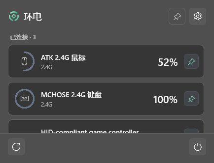

# ATK Nordic 接收器与 MCHOSE G87 键盘实机验证

2026-11-28，在提交者本机（Windows，x64）对两台 2.4G 外设做了只读取数验证。两台设备同时连接，分别位于不同的物理接收器，读数互不干扰。

| 设备 | USB 标识 | 厂商集合 | 读取结果 |
|---|---|---|---|
| MCHOSE G87 键盘 | `41E4:2001`（`MI_01&Col06`） | UsagePage `0xFF04` / Usage `0x0002`，仅 Feature 8 字节 | 100% |
| ATK 2.4G 鼠标 | `373B:1216`（`MI_02&Col02`） | UsagePage `0xFF05` / Usage `0x0001`，Input 64 / Output 64 | 52%，3.92 V |

两台设备同时接入时，环电的设备列表分别显示 52% 与 100%，图标按名称落到鼠标与键盘：



## 迈从键盘

接收器的电池集合只有 Feature 报告，没有输入或输出报告，因此适配器不发送任何命令，仅做一次 `HidD_GetFeature` 读取。

原始回包（8 字节，含报告 ID）：

```
06 00 02 64 64 64 95 58
```

`[0]` 为报告 ID `0x06`，`[3]` 即第三字节载荷为电量（`0x64` = 100%）。连续读取三次结果一致。`[1]`、`[2]` 与 `[6]`、`[7]` 的语义尚未确认，解析时不参与判断，也不据此推断充电状态。

匹配条件限定 `41E4:2001` + `0xFF04`/`0x0002` + Feature 长度恰为 8。该 VID 同时被其他 Compx 键盘使用，同一接收器上还暴露了 `0xFF02`（20/20 字节）等常规集合，这些集合不会被本适配器查询。

## ATK Nordic 鼠标

适配器向 Output 报告 `0x08` 写入 64 字节查询帧：

```
08 7D 72 02 00 01 07 01 00 ... 00
```

有效回包需同时满足 `[0]=0x08`、`[1]=0x72`、`[5]=0x07`，`[7]` 为电量，`[8..9]` 为小端电压（mV）。实测回包：

```
08 72 00 05 00 07 01 34 50 0F
```

即 52%、`0x0F50` = 3920 mV。设备休眠后第一次查询常被丢弃，因此会话先排空残留的输入报告，再最多重试 5 次（间隔 150 ms），单次等待上限约 720 ms；写入被设备拒绝时跳过该次并继续重试。未取得有效回包时返回空列表，不推测电量，也不写入任何配置或灯效命令。

同一接收器的 `0xFFB1`（Output 13）和 `0xFFB3`（Input 13 / Output 65）集合属于其他用途，不在匹配范围内。

## 未覆盖

- 两条协议都没有可验证的充电状态字段，因此不显示充电标记，也不做电压估算。
- 接收器标识可能是同方案多型号共用，遇到不同固件时以「未取得电量」呈现，而不是显示未经验证的数值。
- 键盘通过 USB 有线连接时的标识与协议未采集；鼠标的蓝牙通道仍由 Windows 标准渠道读取。
